

  
  
  
  
  


  



  

  <a href="https://github.com/MaanavKrishna/Aftershock"></a>
  <a href="https://github.com/MaanavKrishna/PyWeb"></a>

  <a href="https://github.com/MaanavKrishna/hum-interpreter"></a>
  <a href="https://github.com/MaanavKrishna/cadabra"></a>

  <a href="https://github.com/MaanavKrishna/deadlock-graphhacks"></a>
  <a href="https://github.com/MaanavKrishna/countersign"></a>

  <a href="https://maanavkrishna.github.io/Portfolio/"></a>
  <a href="https://maanavkrishna.github.io/Portfolio/"></a>

  <a href="https://github.com/MaanavKrishna/couchpad"></a>

  <b>TRY THEM LIVE</b> &nbsp;
  <a href="https://aftershock-mk.vercel.app">Aftershock</a> &nbsp;/&nbsp;
  <a href="https://maanavkrishna.github.io/PyWeb/playground.html">PyWeb playground</a> &nbsp;/&nbsp;
  <a href="https://maanavkrishna.github.io/hum-interpreter/">Hum</a> &nbsp;/&nbsp;
  <a href="https://maanavkrishna.github.io/cadabra/">Cadabra</a> &nbsp;/&nbsp;
  <a href="https://deadlock-graphhacks.vercel.app">Deadlock</a> &nbsp;/&nbsp;
  <a href="https://countersign-self.vercel.app">Countersign</a> &nbsp;/&nbsp;
  <a href="https://maanavkrishna.github.io/couchpad/">couchpad</a>

 

  <a href="https://devhub-sandy.vercel.app"></a>
  <a href="https://bartr-sepia.vercel.app"></a>

  <a href="https://github.com/MaanavKrishna/ZeroBot"></a>
  <a href="https://maanavkrishna.github.io/Web3Beacon/"></a>

<b>The early stuff</b>

 

| Project | What it is |
|---|---|
| [Portfolio](https://github.com/MaanavKrishna/Portfolio) | WebGL "actuator field" portfolio in React 19 and three.js |
| [Plinko Physics Simulator](https://github.com/MaanavKrishna/Plinko-Physics-Simulator) | A normal distribution building itself from bounces (p5.js, Matter.js) |
| [FoodBox](https://github.com/MaanavKrishna/FoodBoxManager) / [Bakery](https://github.com/MaanavKrishna/Online-Bakery-Management-System) / [Diagnostics](https://github.com/MaanavKrishna/Diagnostic-Center-Management-System) / [Gaming](https://github.com/MaanavKrishna/Gaming-Management-System) / [Education](https://github.com/MaanavKrishna/Education-Management-System) | Python and MySQL management systems with reports |

 

  



  

  
  

  

<picture>
  <source media="(prefers-color-scheme: dark)" srcset="https://raw.githubusercontent.com/MaanavKrishna/MaanavKrishna/output/snake-dark.svg" />
  <source media="(prefers-color-scheme: light)" srcset="https://raw.githubusercontent.com/MaanavKrishna/MaanavKrishna/output/snake-light.svg" />
  
</picture>

  


  I'm open to <b>internships and research collaborations</b> in software engineering, ML and quant. 
  If you're building something hard and honest, I'd love to hear about it.

  
  
  

