<a href="https://maanavkrishna.github.io/Portfolio/">
  
</a>

  
  
  
  

 


  <a href="https://github.com/MaanavKrishna/Aftershock"></a>
  <a href="https://github.com/MaanavKrishna/PyWeb"></a>

  <a href="https://github.com/MaanavKrishna/hum-interpreter"></a>
  <a href="https://github.com/MaanavKrishna/cadabra"></a>

  <a href="https://github.com/MaanavKrishna/deadlock-graphhacks"></a>
  <a href="https://github.com/MaanavKrishna/countersign"></a>
  <a href="https://github.com/MaanavKrishna/couchpad"></a>

  <a href="https://maanavkrishna.github.io/Portfolio/"></a>

  
    <b>TRY THEM LIVE</b> &nbsp;
    <a href="https://aftershock-mk.vercel.app">Aftershock</a> &nbsp;·&nbsp;
    <a href="https://maanavkrishna.github.io/PyWeb/playground.html">PyWeb playground</a> &nbsp;·&nbsp;
    <a href="https://maanavkrishna.github.io/hum-interpreter/">Hum</a> &nbsp;·&nbsp;
    <a href="https://maanavkrishna.github.io/cadabra/">Cadabra</a> &nbsp;·&nbsp;
    <a href="https://deadlock-graphhacks.vercel.app">Deadlock</a> &nbsp;·&nbsp;
    <a href="https://countersign-self.vercel.app">Countersign</a> &nbsp;·&nbsp;
    <a href="https://maanavkrishna.github.io/couchpad/">couchpad</a>
  

 


<a href="https://devhub-sandy.vercel.app"></a>
<a href="https://bartr-sepia.vercel.app"></a>
<a href="https://github.com/MaanavKrishna/ZeroBot"></a>
<a href="https://maanavkrishna.github.io/Web3Beacon/"></a>

<b>EARLIER WORK</b>

 

[Portfolio](https://github.com/MaanavKrishna/Portfolio) (React 19, three.js) · [Plinko Physics Simulator](https://github.com/MaanavKrishna/Plinko-Physics-Simulator) (p5.js, Matter.js) · Python and MySQL management systems: [FoodBox](https://github.com/MaanavKrishna/FoodBoxManager), [Bakery](https://github.com/MaanavKrishna/Online-Bakery-Management-System), [Diagnostics](https://github.com/MaanavKrishna/Diagnostic-Center-Management-System), [Gaming](https://github.com/MaanavKrishna/Gaming-Management-System), [Education](https://github.com/MaanavKrishna/Education-Management-System)

 



  



  


<picture>
  <source media="(prefers-color-scheme: dark)" srcset="https://raw.githubusercontent.com/MaanavKrishna/MaanavKrishna/output/snake-dark.svg" />
  <source media="(prefers-color-scheme: light)" srcset="https://raw.githubusercontent.com/MaanavKrishna/MaanavKrishna/output/snake-light.svg" />
  
</picture>

  

<a href="mailto:maanavkrishna@gmail.com"></a>
